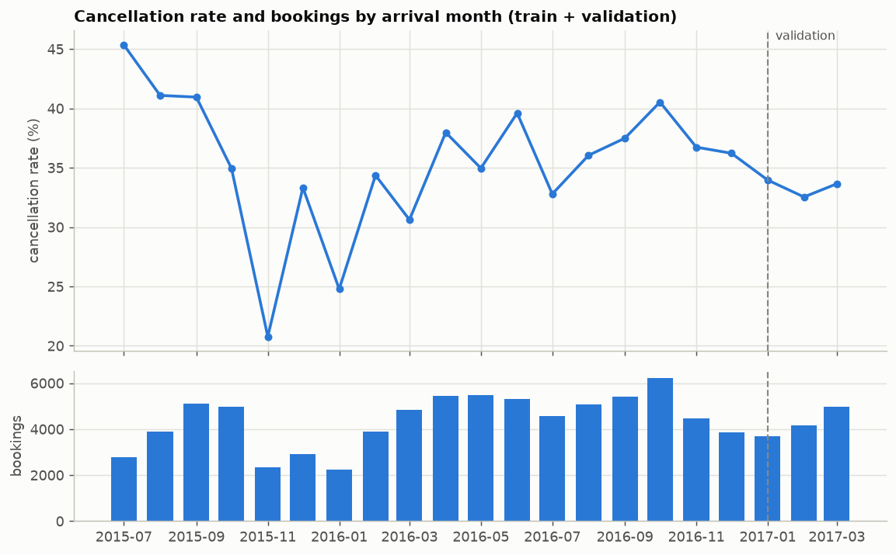
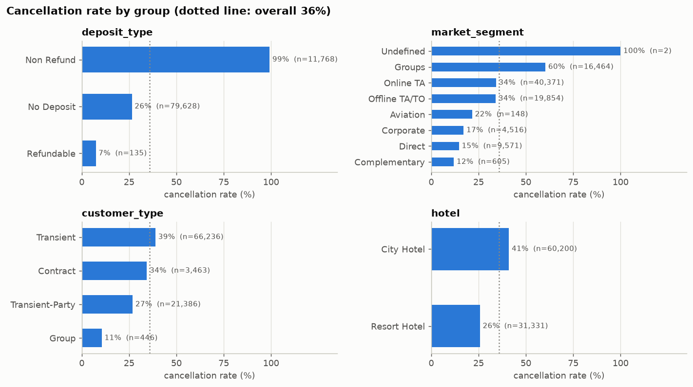
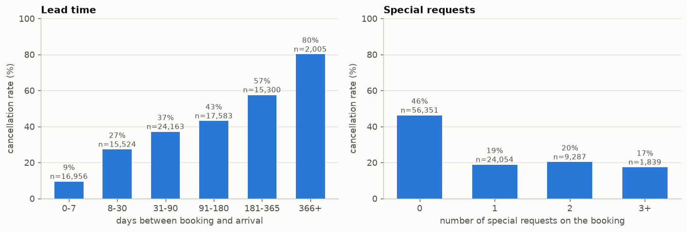
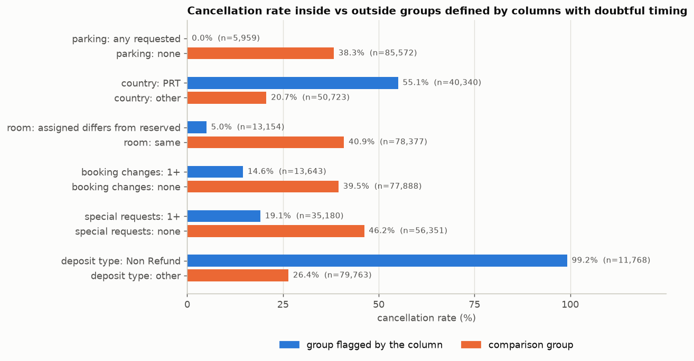
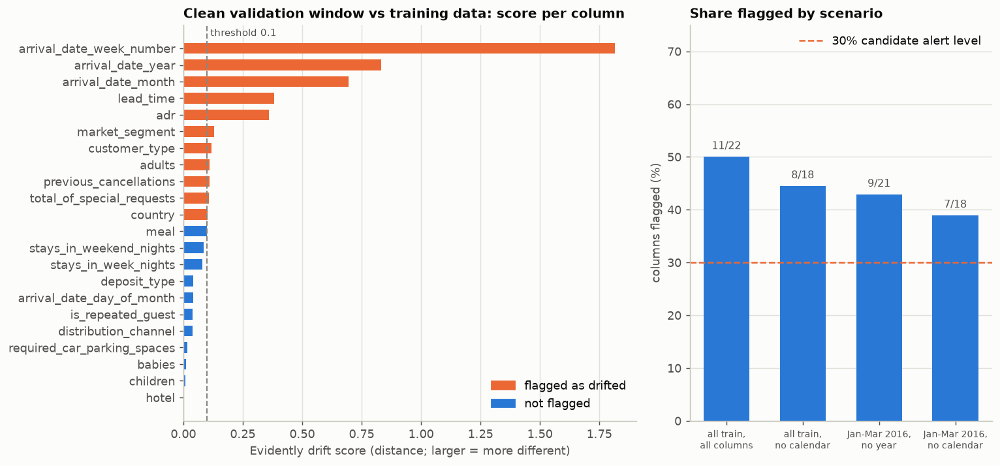
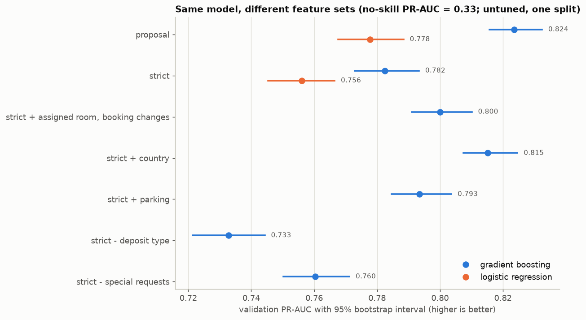

# EDA findings

Every number below comes from `python -m src.eda.run_eda` (raw values in `docs/eda_results.json`,
figures in `docs/figures/`). Data: TidyTuesday 2020-02-11 hotel bookings, 119,390 rows, 32 columns,
two Portuguese hotels, arrivals 2015-07-01 to 2017-08-31. Target: `is_canceled`. One row is one booking.

## 0. Scope and test-set isolation

The EDA reads **train and validation only**: 91,531 rows, arrivals 2015-07-01 to 2017-03-31
(`load_design_data` cannot return test rows; `tests/test_splits.py` checks that it runs without a
holdout file). The test split (arrivals 2017-04-01 onward, 27,859 rows) is not used anywhere in this
repository's code.

Disclosure: before this repository existed, the test split was inspected once while reviewing an earlier
project proposal (class balance, drift on clean data, a feature-leakage check). The findings here are
re-derived from train and validation only, but the test split should be treated as already seen at the
summary level when the production-validation stage is judged.

Timing statements about columns come from the data article (Antonio, de Almeida, Nunes 2019, *Data in
Brief* 22, 41-49): the snapshot of each booking is the day before arrival, using the booking change log
where possible; `booking_changes` counts amendments until check-in or cancellation; `deposit_type` is
computed from payments recorded before the arrival or cancellation date; `assigned_room_type` can differ
from the reserved one for hotel operational reasons (for example overbooking); hotels often do not know a
guest's nationality until check-in. The article says nothing about when parking requests or special
requests are recorded. The data cannot prove when a column is known; section 5 separates what the article
says from what the data pattern suggests.

## 1. Data at a glance

| | Train | Validation | Together |
|---|---|---|---|
| Arrivals | 2015-07-01 to 2016-12-31 | 2017-01-01 to 2017-03-31 | |
| Rows | 78,703 | 12,828 | 91,531 |
| Cancellation rate | 36.2% | 33.4% | 35.8% |

| Hotel | Rows | Cancellation rate |
|---|---|---|
| City Hotel | 60,200 | 41.0% |
| Resort Hotel | 31,331 | 25.7% |

Missing values (train + validation): `children` 4, `country` 468. `agent` (13,217) and `company` (85,917)
are empty because the booking did not come through an agent or company (article), not because data is lost.

## 2. Data quality

| Check | Count (of 91,531) | Note |
|---|---|---|
| Exact duplicate rows (after the first copy) | 26,009 (28.4%) | 62.6% of them are canceled, against 35.8% overall |
| `adr` negative | 1 | |
| `adr` equal to 0 | 1,710 | |
| `adr` at least 1,000 | 1 | maximum 5,400 |
| No guests (adults + children + babies = 0) | 151 | |
| Zero nights | 656 | |
| `meal` = Undefined | 1,039 | kept as its own category |
| `market_segment` / `distribution_channel` = Undefined | 2 / 5 | |
| `lead_time` maximum | 737 days | |

Duplicates: there is no booking ID, so a duplicate cannot be told from two genuinely identical bookings
(for example a group booking). Identical rows share their arrival date, so a duplicate never lands in
both train and validation. They still count several times in training and in every metric.

## 3. Cancellations over time



- The monthly cancellation rate moves between 20.8% (2015-11) and 45.4% (2015-07); bookings per month
  between 2,248 and 6,203.
- The three validation months sit at 34.0%, 32.5% and 33.6%, below the training average of 36.2%.
- Both extremes fall in the first training months: 45.4% in 2015-07 (2,776 bookings) and 20.8% in 2015-11
  (2,340 bookings).

## 4. What separates canceled from kept bookings




| Signal | Finding |
|---|---|
| `deposit_type` | Non Refund 99.2% canceled (11,768 rows), No Deposit 26.5% (79,628), Refundable 7.4% (135) |
| `lead_time` | rises steadily: 9.4% for 0-7 days, 27.3% for 8-30, 37.1% for 31-90, 43.1% for 91-180, 57.5% for 181-365, 80.1% beyond 365 |
| `market_segment` | Groups 60.3% (16,464 rows); Online TA 34.2%; Offline TA/TO 34.0%; Corporate 17.1%; Direct 14.6% |
| `distribution_channel` | TA/TO 39.8% (74,226 rows); Direct 17.0%; Corporate 21.2% |
| `customer_type` | Transient 38.9%; Contract 34.4%; Transient-Party 26.9%; Group 10.5% (446 rows) |
| `previous_cancellations` > 0 | 93.4% canceled (6,319 rows) against 31.5% |
| `is_repeated_guest` | 16.3% canceled (3,102 rows) against 36.5% |
| `total_of_special_requests` | 0 requests: 46.2% (56,351 rows); 1: 18.8%; 2: 20.3%; 3 or more: 17.4% |

The non-refundable result is the strangest: 99.2% of non-refundable bookings are canceled. The simple rule
"flag Non Refund" has 99.5% precision on validation but only 30.4% recall (it flags 10.2% of bookings).

## 5. Feature timing audit



`reservation_status` separates the target perfectly (Canceled 31,741 and No-Show 1,019 are all canceled;
Check-Out 58,771 are all kept), so `reservation_status` and `reservation_status_date` are never features.

| Column | Inside the group | Outside | What the article says | Decision for now |
|---|---|---|---|---|
| `required_car_parking_spaces` > 0 | 0.0% canceled (5,959) | 38.3% (85,572) | nothing on timing | Out of the default set: zero cancellations among 5,959 requests is the pattern of a field filled at check-in. Ask the hotel when it is recorded. |
| `country` = PRT | 55.1% (40,340) | 20.7% (50,723) | nationality is often unknown until check-in | Out of the default set; 468 rows with missing country excluded from this comparison |
| `assigned_room_type` differs from reserved | 5.0% (13,154) | 40.9% (78,377) | can change for hotel operational reasons | Out (defined at or after check-in) |
| `booking_changes` > 0 | 14.6% (13,643) | 39.5% (77,888) | counted until check-in or cancellation | Out |
| `deposit_type` = Non Refund | 99.2% (11,768) | 26.4% (79,763) | computed from payments recorded before arrival or cancellation | **In, but flagged** (see section 7: the model loses the most without it) |
| `total_of_special_requests` > 0 | 19.1% (35,180) | 46.2% (56,351) | nothing on timing | **In, but flagged**: requests can be added after booking |

## 6. Drift on clean data



Question: if validation rows (no corruption at all) were sent through a monitor built on Evidently's
defaults, how many columns would it flag? Evidently 0.7.23 defaults to distance-based tests per column; in
every scenario below all columns came out with the same threshold, 0.1, and a column counts as drifted at 0.1
or more. (That is why the share at other thresholds can be computed from the scores; the script checks it
reproduces Evidently's own count at 0.1.)

| Reference | Columns | Flagged at 0.1 | Share at 0.1 | Share at 0.15 | Share at 0.2 | Share at 0.3 |
|---|---|---|---|---|---|---|
| S1: all train (78,703 rows), all columns | 22 | 11 | 50.0% | 22.7% | 22.7% | 22.7% |
| S2: all train, calendar columns removed | 18 | 8 | 44.4% | 11.1% | 11.1% | 11.1% |
| S3: Jan-Mar 2016 (10,963 rows), year removed | 21 | 9 | 42.9% | 19.0% | 14.3% | 9.5% |
| S4: Jan-Mar 2016, calendar columns removed | 18 | 7 | 38.9% | 16.7% | 11.1% | 5.6% |

Calendar columns are the most extreme scores (`arrival_date_week_number` 1.82, `arrival_date_year` 0.83,
`arrival_date_month` 0.70), which is expected: validation covers January to March 2017 and training covers
other months and years. They are not the whole story:

- Even against the same season one year earlier with calendar columns removed (S4), 7 of 18 columns are
  flagged at 0.1, above a 30% alert level.
- Most flagged columns sit just above the threshold: `market_segment` 0.129, `customer_type` 0.119,
  `adults` 0.110, `previous_cancellations` 0.109, `total_of_special_requests` 0.107, `country` 0.103.
  `lead_time` (0.383) and `adr` (0.361) are clearly different.
- With a per-column threshold of 0.2, the clean validation window flags 11.1% to 22.7% of columns across the
  four scenarios, and 11.1% in both calendar-free ones.

## 7. Exploratory baselines (fit on train, scored on validation)

No tuning, one seed, one split: a screening tool, not model results. Gradient boosting is scikit-learn's
`HistGradientBoostingClassifier` with defaults; intervals are 95% bootstrap intervals over validation rows
(300 resamples, paired for the differences).



| Feature set (gradient boosting) | Features | PR-AUC [95% CI] | ROC-AUC | PR-AUC minus strict [95% CI] |
|---|---|---|---|---|
| proposal list (earlier proposal) | 22 | 0.8236 [0.8157, 0.8324] | 0.8837 | +0.0410 [+0.0349, +0.0475] |
| **strict** (no country, parking, year) | 19 | 0.7825 [0.7729, 0.7933] | 0.8439 | reference |
| strict + assigned room, booking changes, reserved room | 22 | 0.8000 [0.7910, 0.8101] | 0.8590 | +0.0175 [+0.0140, +0.0209] |
| strict + country | 20 | 0.8151 [0.8074, 0.8246] | 0.8725 | +0.0326 [+0.0267, +0.0387] |
| strict + parking | 20 | 0.7934 [0.7846, 0.8036] | 0.8562 | +0.0108 [+0.0085, +0.0130] |
| strict, without `deposit_type` | 18 | 0.7328 [0.7214, 0.7443] | 0.8221 | -0.0498 [-0.0561, -0.0438] |
| strict, without special requests | 18 | 0.7604 [0.7502, 0.7712] | 0.8292 | -0.0222 [-0.0293, -0.0165] |

| Reference models | PR-AUC | Notes |
|---|---|---|
| Majority class (always "not canceled") | 0.3337 | equals the validation cancellation rate; recall 0 |
| Rule: flag Non Refund | not a score | precision 99.5%, recall 30.4%, flags 10.2% of bookings |
| Logistic regression, strict | 0.7560 [0.7453, 0.7665] | ROC-AUC 0.8140 |
| Logistic regression, proposal list | 0.7778 [0.7676, 0.7884] | ROC-AUC 0.8472 |

Reading:

- Country, parking and year together are worth about 0.04 PR-AUC to a default gradient-boosting model (country alone about 0.03). Dropping them costs accuracy and
  removes the columns most likely to be unavailable at prediction time.
- The strict set still leans on `deposit_type` (about 0.05 PR-AUC) and special requests (about 0.02), both of
  which have unclear timing. The performance of any model built on this set depends on the answer to "when is
  each column known".
- Logistic regression trails gradient boosting by 0.03 to 0.05 PR-AUC on the same features.

## 8. Proposed decisions for the pipeline (to confirm with the team)

1. **Fix the prediction time first.** Write down when the model is called ("at booking", or "N days before
   arrival") and keep only columns known at that moment. Everything below depends on it.
2. **Default feature set = strict.** Report the proposal list only as an optimistic ablation. Never use the
   `reservation_status*` columns.
3. **Resolve `deposit_type` and special requests with the data owner.** If `deposit_type` is only final
   after payments, a model that uses it at booking time is partly reading the future.
4. **Data validation at ingestion must pass the clean data.** The raw data already holds a negative `adr`,
   zero-guest rows and Undefined categories (section 2). Validation rules should flag or quarantine and count
   these, not reject the file, otherwise the clean baseline run fails before the drift experiments begin.
5. **Monitoring: exclude calendar columns, calibrate the alert level on clean data.** Evidently defaults flag
   39% to 50% of columns on clean validation data, so a "more than 30% of columns drifted" alert fires on
   clean traffic. Choose the per-column threshold and the share from clean runs (section 6), then check that
   the corrupted-data scenarios cross it.
6. **Keep duplicates in the first model and test their effect later**, since they cannot be separated from
   real repeated bookings (section 2).
7. **Primary metric PR-AUC** (no-skill level 0.33), plus precision and recall at the chosen threshold. The
   cost ratio behind the threshold is an assumption for the team to agree on. Cancellation rates move by
   month (section 3), so a threshold chosen on three validation months needs re-checking on another window.

## 9. Limitations

- The ablations are untuned, single-split, single-seed. The bootstrap intervals treat rows as independent;
  with 28% duplicates and bookings made on the same day, they are narrower than the true uncertainty.
- The timing of columns is judged from the article and from data patterns, not from the hotel's systems.
- `country`, `parking`, `assigned_room_type` and `booking_changes` were excluded for timing reasons; whether
  any of them is available at prediction time in a real deployment is a business question.
- The drift scores use Evidently defaults only. Other tests or sample sizes would change the shares.
- This dataset is static: every booking already has its outcome. A real deployment would learn the outcome
  only after the stay or the cancellation, which changes how label-based monitoring (performance, concept
  drift) can work.

## Reproduce

```bash
python -m src.ingestion.download && python -m src.data.make_splits && python -m src.eda.run_eda
```

Runtime about 45 seconds on a laptop. Figure colors come from a color-vision-deficiency-checked palette
(blue and orange); values are printed on the bars so no meaning rests on color alone.
