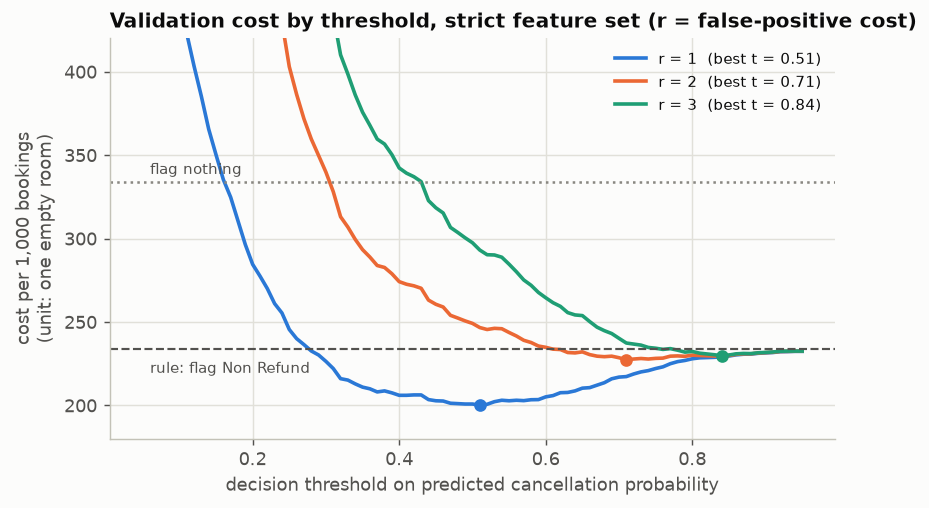

# Stage 1 decisions: prediction time, feature set, cost ratio

Decided by the stage 1 owner (Hoon) on 2026-11-25 for the stage 2 training pipeline. Open for team review
in the pull request that adds this file. Every number comes from `docs/decision_results.json`, produced by
`python -m src.eda.decision_analysis` on train and validation only. The test split is not loaded.

## Summary

| Decision | Choice |
|---|---|
| Prediction time | Score each active booking before arrival, using only fields of the booking record |
| Feature set | `STRICT` in `src/data/columns.py` (19 columns), **keeping `deposit_type`** |
| Cost ratio | A false positive costs **2** empty rooms (r = 2); a false negative costs 1 |
| Decision threshold | Predicted probability ≥ r / (1 + r) = **0.667**, after a calibration check |
| Baselines the model must beat | Flag nothing **and** the rule "flag every Non Refund booking", on cost at r = 2 |

## 1. Prediction time

The model scores bookings that are still active, at any point before arrival. This matches the use the data
authors describe: contacting high-risk customers before the expected arrival date (Antonio, de Almeida,
Nunes 2019, *Big Data in Hotel Revenue Management*). Their extraction also fixes the snapshot: features of
kept bookings are taken before check-in, and features of canceled bookings on the cancellation date.

Only fields that exist on the booking record at that time are allowed. Fields filled in at or after
check-in are out (section 2).

## 2. Feature set: `STRICT`, keeping `deposit_type`

`STRICT` (19 columns): lead time, arrival week, day of month and month, weekend and week nights, adults,
children, babies, repeated guest, previous cancellations, ADR, special requests, hotel, meal, market
segment, distribution channel, deposit type, customer type.

Excluded, with the reason (details in `docs/eda_findings.md`, section 5):

| Column | Why it is out |
|---|---|
| `reservation_status`, `reservation_status_date` | They are the outcome |
| `country` | Often only confirmed at check-in |
| `required_car_parking_spaces` | Recorded at arrival |
| `assigned_room_type`, `booking_changes` | Change up to and at check-in |
| `arrival_date_year` | Never repeats in the future, so it cannot generalize |

`STRICT` costs about 0.04 PR-AUC against the earlier proposal list (`docs/eda_findings.md`, section 7). We
accept that: the proposal list scores higher partly because it reads columns the hotel does not have yet.

**Why `deposit_type` stays.** Non Refund bookings are canceled 99% of the time in this data, which looks
like leakage. The data authors explain it differently in a study of Portuguese hotels: canceled
non-refundable bookings come mostly from certain countries and channels, made through online travel agencies with false or
invalid card details to support Portuguese visa applications. The hotel only finds out when the charge
fails. So the value is set when the booking is made, and flagging these bookings early is the job the
model is meant to do. Dropping the column would cost about 0.05 PR-AUC (`eda_findings.md`, section 7).

Remaining risk: the data paper defines deposit type by payment (full payment before arrival means "Non
Refund"), and the data has no timestamp for when the value was set. If some bookings only became Non
Refund after a later payment, part of the signal comes from after the booking date. We cannot test this
with the public data, so it is listed as a limitation. Special requests carry the same caveat.

## 3. Cost ratio r = 2

The action behind a positive prediction is assumed to be **targeted overbooking**: the room of a flagged
booking is sold again.

- **False negative** (a cancellation the model misses): the room stays empty. Cost 1, the unit.
- **False positive** (a flagged booking whose guest arrives): the hotel has no room and must "walk" the
  guest to another hotel, paying for the room, transport and goodwill. Cost r.

Cornell's hospitality research gives an example where walking costs 3 times an empty room, and says some
hotels use 2 times as a rule of thumb (eCornell, *The cheapest and best approach to overbooking*). We take
**r = 2** and report r = 1 and r = 3 as sensitivity. r = 2 is an assumption, not a measured cost: the hotel
data has no compensation or capacity figures.

## 4. Threshold rule

With calibrated probabilities, flagging a booking pays off when its cancellation probability exceeds
r / (1 + r). At r = 2 that is **0.667**.

We use this fixed value instead of the threshold that minimizes cost on validation. The cost-minimizing
threshold at r = 2 is 0.71 on the full validation set, but it moves between 0.67 and 0.84 across bootstrap
resamples (5th to 95th percentile). A threshold picked on validation also flatters the validation score.

The fixed rule needs calibrated probabilities. For the exploratory model they are close: Brier score
0.141, mean prediction 0.316 against an observed rate of 0.334. The middle deciles under-predict (decile 6:
0.227 predicted, 0.313 observed), but near the threshold the fit is good (decile 9: 0.694 predicted, 0.654
observed). **Stage 2 must repeat this check for the champion model** and calibrate it if it fails.

## 5. Evidence (exploratory model, validation)

Model: `HistGradientBoostingClassifier` with defaults on `STRICT`, fit on train, scored on the 12,828
validation bookings (PR-AUC 0.7825). Cost per 1,000 bookings, in empty rooms. Intervals: 300 paired
bootstrap resamples.

| r | Threshold r/(1+r) | Model cost | Flag nothing | Non Refund rule | Model saving vs rule [95% CI] | Precision | Recall |
|---|---|---|---|---|---|---|---|
| 1 | 0.500 | 200.8 | 333.7 | 232.9 | +32.1 [+26.0, +38.4] | 0.790 | 0.543 |
| **2** | **0.667** | **229.3** | 333.7 | 233.5 | **+4.2 [−2.0, +9.7]** | 0.885 | 0.422 |
| 3 | 0.750 | 234.3 | 333.7 | 234.0 | −0.2 [−4.8, +4.2] | 0.951 | 0.353 |

**Main finding: at r = 2 the default model is not clearly better than the one-line Non Refund rule.**
Both cut the cost of flagging nothing by about 30%, but the model's extra saving over the rule
has an interval that includes zero.

Where the model adds anything: at 0.667 it flags 1,298 of the 1,307 Non Refund bookings, the same ones the
rule catches. Its 744 other flags are right 68.6% of the time, barely above the 66.7% precision needed to
break even at r = 2. On bookings that are not Non Refund, its PR-AUC is 0.540 against a base rate of 0.259.

Per validation month at 0.667: January precision 0.945, recall 0.426; February 0.882 and 0.346; March 0.852
and 0.482.

## 6. What this means for stage 2

1. Train on `STRICT`. Report the proposal list only as an optimistic ablation.
2. Log these metrics in MLflow for every run, on validation:
   - PR-AUC (primary ranking metric)
   - cost per 1,000 bookings at r = 2 and threshold 0.667, with precision and recall
   - PR-AUC on bookings that are not Non Refund
   - Brier score
3. A model becomes **champion** only if its cost at r = 2 is below the Non Refund rule's (233.5 per 1,000
   on validation) with a bootstrap interval that excludes zero. The default model does not pass this yet,
   so tuning should target the No Deposit bookings, where the rule has nothing to say.
4. If calibration fails, calibrate on a slice of train (not on validation) and re-check.

## 7. Limitations

- **r is an industry rule of thumb**, not this hotel's cost. A walk only happens when the hotel is
  actually full, so the true false-positive cost is probably lower. At r = 1 the model beats the rule by
  32 rooms per 1,000 bookings.
- **Cost is per booking**, not weighted by revenue. Long or expensive stays matter more in reality.
- **Validation covers January to March 2017 only.** Cancellation rates vary by month
  (`eda_findings.md`, section 3), and the test months (April to August) are not in validation, so
  precision and recall at 0.667 will move. The production check on the test split will show by how much.
- **`deposit_type` and special requests have no timestamp** (section 2).

## Sources

- Antonio, N., de Almeida, A., Nunes, L. (2019). Big Data in Hotel Revenue Management: Exploring
  Cancellation Drivers to Gain Insights Into Booking Cancellation Behavior. *Cornell Hospitality
  Quarterly*. Author postprint: https://repositorio.iscte-iul.pt/bitstream/10071/18184/1/BigDataCancellationPrediction_posprint.pdf
- eCornell Impact. The cheapest and best approach to overbooking.
  https://ecornell-impact.cornell.edu/the-cheapest-and-best-approach-to-overbooking/
